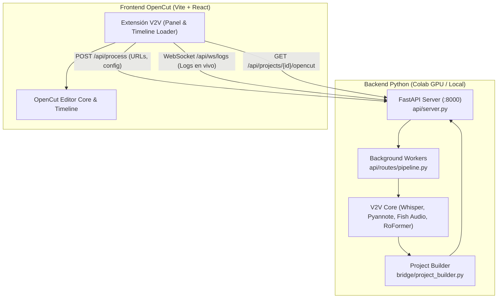

# Integración V2V ↔ OpenCut: Arquitectura y Guía de Replicación

Este documento detalla la integración técnica entre el pipeline de doblaje/traducción **Video2Video (V2V)** y el editor de video open-source **OpenCut**. Explica la arquitectura, los componentes añadidos y los pasos exactos para replicar o actualizar esta integración.

---

## 1. Filosofía de Diseño y Arquitectura

### 1.1. Principio de Desacoplamiento
Para garantizar que futuras actualizaciones de OpenCut no rompan nuestra funcionalidad, se adopta una arquitectura basada en **Git Subtree + API REST**:
- El código de OpenCut se aloja en su propio subdirectorio (`opencut/`) y se gestiona como un repositorio upstream aislado.
- Toda la lógica pesada de Inteligencia Artificial (Whisper, Pyannote, RoFormer, Fish Audio TTS, FFmpeg) corre en el entorno Python con GPU y se expone mediante una **API REST (FastAPI)**.
- La interfaz de usuario interactúa con la API y monta los resultados directamente en el timeline y estado de OpenCut mediante una extensión modular.



---

## 2. Componentes Añadidos y Estructura de Archivos

```
v2v/
├── api/                           # [NUEVO] Capa de servicio REST
│   ├── __init__.py
│   ├── schemas.py                 # Modelos Pydantic de requests/responses
│   ├── server.py                  # Servidor FastAPI principal con CORS y endpoints
│   └── routes/
│       ├── __init__.py
│       ├── pipeline.py            # POST /api/process, GET /api/status/{id}
│       ├── projects.py            # GET /api/projects, GET /api/projects/{id}/opencut
│       └── status.py              # WebSocket /api/ws/logs/{id} (streaming de logs)
│
├── bridge/                        # [NUEVO] Conversión de datos V2V a OpenCut
│   ├── __init__.py
│   ├── opencut_schema.py          # Esquemas del modelo de datos de OpenCut
│   └── project_builder.py         # Constructor de tracks, clips de video, audios y subtítulos
│
├── opencut-v2v-extension/         # [NUEVO] Extensión UI desacoplada para OpenCut
│   ├── V2VPanel.tsx               # Panel para ingresar URLs, elegir voz y ver progreso
│   ├── api-client.ts              # Cliente TypeScript para comunicarse con FastAPI
│   └── types.ts                   # Tipos TypeScript compartidos
│
├── opencut/                       # [GIT SUBTREE] Código de OpenCut upstream
│   ├── apps/
│   │   ├── web/                   # Aplicación Web React
│   │   └── ...
│   └── ...
│
├── src/                           # Pipeline V2V original (Python)
│   ├── config.py
│   ├── tts.py                     # Integración Fish Audio TTS
│   ├── pipeline.py
│   └── ...
│
├── colab_launch.ipynb             # [ACTUALIZADO] Notebook unificado para Google Colab
├── requirements.txt               # [ACTUALIZADO] Dependencias Python (FastAPI, uvicorn, etc.)
└── INTEGRATION.md                 # [ESTE ARCHIVO] Documentación técnica y guía de replicación
```

---

## 3. Guía Paso a Paso para Replicar la Integración

Si necesitas replicar esta configuración en un repositorio limpio o en otro proyecto, sigue estos pasos:

### Paso 1: Crear la rama de integración
```bash
git checkout -b opencut_launch
```

### Paso 2: Limpiar dependencias antiguas (quitar Gradio)
1. En `requirements.txt`:
   - Eliminar `gradio`.
   - Agregar:
     ```txt
     fastapi>=0.110.0
     uvicorn[standard]>=0.28.0
     python-multipart>=0.0.9
     websockets>=12.0
     ```
2. Eliminar `app_gradio.py` si existe:
   ```bash
   git rm app_gradio.py
   ```

### Paso 3: Copiar los módulos `api/` y `bridge/`
1. Crear el directorio `api/` con `schemas.py`, `server.py` y las rutas en `api/routes/`.
2. Crear el directorio `bridge/` con `opencut_schema.py` y `project_builder.py`.
3. Hacer commit de estos cambios:
   ```bash
   git add api/ bridge/ requirements.txt
   git commit -m "feat: add FastAPI server and OpenCut bridge"
   ```

### Paso 4: Añadir OpenCut como Git Subtree
Para incorporar OpenCut sin perder su trazabilidad ni ensuciar el historial:
```bash
# 1. Agregar el remote upstream
git remote add opencut-upstream https://github.com/OpenCut-app/OpenCut.git

# 2. Agregar el subtree en la carpeta 'opencut'
git subtree add --prefix=opencut opencut-upstream main --squash
```

### Paso 5: Actualizar OpenCut en el futuro
Cuando el equipo de OpenCut lance nuevas versiones o libere su sistema de plugins oficial:
```bash
git subtree pull --prefix=opencut opencut-upstream main --squash
```
Al mantener nuestra lógica en `api/`, `bridge/` y `opencut-v2v-extension/`, las actualizaciones de OpenCut se fusionan sin conflictos en nuestro código de IA.

---

## 4. Funcionamiento del Timeline y Sincronización

Cuando un video de YouTube se procesa a través de V2V:
1. **Separación de Pistas**:
   - `video`: Video descargado en MP4.
   - `vocals_es.wav`: Voz doblada en español con clonación de voz (Fish Audio).
   - `no_vocals.wav`: Pista instrumental/efectos de fondo extraída con RoFormer.
   - `texts.pkl`: Tiempos exactos `[start, end]` de cada diálogo traducido.

2. **Mapeo a OpenCut**:
   `bridge/project_builder.py` genera un `OpenCutProject` que contiene:
   - **Track 1 (Video)**: Clip de video posicionado en `startTime: 0.0`.
   - **Track 2 (Audio - Doblaje)**: Pista de audio con la voz clonada (`vocals_es.wav`), sincronizada.
   - **Track 3 (Audio - Música de Fondo)**: Pista instrumental (`no_vocals.wav`) con volumen equilibrado.
   - **Track 4 (Subtítulos)**: Clips de texto individuales colocados exactamente en los timestamps de inicio y fin de cada frase.

3. **Manipulación en OpenCut**:
   El usuario puede en el timeline de OpenCut:
   - Recortar (trim), dividir (split) y mover cualquier segmento.
   - Ajustar el volumen individual de la voz doblada vs la música de fondo.
   - Modificar o reubicar subtítulos.
   - Exportar el resultado final.

---

## 5. Ejecución en Google Colab

El notebook `colab_launch.ipynb` automatiza la ejecución completa:

1. **Celda 1**: Clona el repositorio e instala las dependencias de Python y Bun/Node.
2. **Celda 2**: Configura variables de entorno (`GOOGLE_API_KEY`, `FISH_API_KEY`) y opcionalmente monta Google Drive.
3. **Celda 3**: Inicia el servidor FastAPI en `:8000`, el servidor Vite de OpenCut en `:5173` y expone la aplicación con un túnel seguro (`cloudflared`).
4. El usuario hace clic en el enlace público generado y tiene acceso completo al editor OpenCut con el pipeline V2V.
